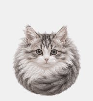
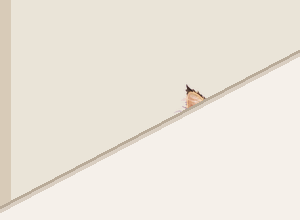

# kimi · Codex 桌面宠物

大家好呀！这是我的小猫Kimi！kimi 是一只长毛赛尔凯克卷毛小猫。Codex 工作时，它把白爪藏进肚皮，尾巴裹住自己，团成毛球转圈。转到侧面，它会突然弓起背、炸起毛，把大尾巴竖成一把瓶刷，再缩回毛球里。



## 安装到 Codex

把下面的整行链接复制到浏览器地址栏，按回车，在 Codex 打开的安装页确认。这条链接使用 v2 动画图集。

```text
codex://pets/install?name=kimi&imageUrl=https%3A%2F%2Fraw.githubusercontent.com%2FLiyuanMAI%2FKimi%2F59bd1d4e6abc9f8f4d3b99869a1978c34ad102d5%2Fkimi%2Fspritesheet.webp&spriteVersionNumber=2
```

也可以手动安装：

1. [下载 kimi 桌宠 ZIP](https://github.com/LiyuanMAI/Kimi/archive/refs/tags/v1.0.0.zip)，解压后找到包含 `pet.json` 和 `spritesheet.webp` 的内层 `kimi` 文件夹。
2. Windows 用户把这个文件夹放进 `%USERPROFILE%\.codex\pets\`。macOS 用户放进 `~/.codex/pets/`。如果设置过 `CODEX_HOME`，请使用该目录下的 `pets` 文件夹。
3. 在桌面客户端打开「设置 → 宠物（Pets）」，刷新并选中 **kimi**。如果浮窗已收起，点「唤醒宠物（Wake Pet）」。

工作转圈使用原生的 `running` 状态。六帧循环里，五帧是毛球，一帧是侧身「小恐龙」。这个动作每圈出现一次。闲下来时，kimi 会坐好，慢慢眨眼。

## 探头动作预览



这段 GIF 参考了 kimi 藏在挡板后面偷看的照片。当前原生宠物格式没有专用的贴边动作槽，因此拖到屏幕边缘时，客户端不会触发这段动画。

## 文件

| 文件 | 用途 |
| --- | --- |
| `kimi/pet.json` | Codex 桌宠名称和格式版本 |
| `kimi/spritesheet.webp` | 透明动画图集，含九种状态和十六个注视方向 |
| `previews/` | 实际工作动画与探头效果示意 |

美术由 ImageGen 参考 kimi 的照片绘制。仓库分享的是桌宠成品和预览图。

## Install in English

kimi is a long-haired tabby-and-white kitten for Codex Desktop. When Codex works, the kitten curls into a spinning ball, then arches sideways with a puffed-up tail.

[Download the pet](https://github.com/LiyuanMAI/Kimi/archive/refs/tags/v1.0.0.zip). Extract the ZIP and copy the inner `kimi` folder to `~/.codex/pets/` (Windows: `%USERPROFILE%\.codex\pets\`). Open **Settings → Pets**, refresh, and select **kimi**. The link above the manual instructions opens the native install flow in supported desktop clients.
